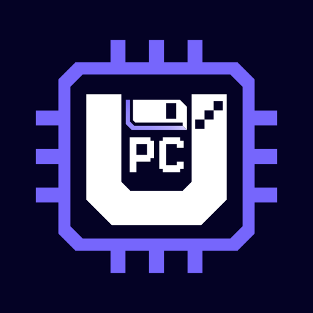

# unemupc

A deterministic, low-level emulator (LLE) of an **IBM PC/AT-class (Intel 80286)
computer**, with an OCI-based library of machines, installation media and
firmware. The CPU core is the `x86jit` x86 recompiler, consumed as a pinned git
dependency.

The 286 AT is the first machine profile on a longer road: a period PC that runs
DOS games now, and Windows 98 SE games on an emulated 3dfx Voodoo later
(`backlog/decisions/decision-16*`).

## Status

**MVP feature complete (2026-11-15)**: an AT 286 DOS games machine with a stable
OCI image ecosystem. The project is now in a **feature freeze**: work goes into
fixes, stability, tests and documentation, not new features. What works, in
detail and with evidence, is in [`backlog/docs/status.md`](backlog/docs/status.md).
Open work is tracked in [beads](https://github.com/steveyegge/beads), whose
database travels with the repository: after cloning, install `bd` (1.3.1 or
newer), run `bd bootstrap`, then `bd ready --exclude-type epic`; see
[`backlog/docs/dev-setup.md`](backlog/docs/dev-setup.md#beads-bd).

Priorities, in order: **testability** (every device tested in isolation on a
mock bus, every machine-level feature behind a deterministic golden test),
**swappability** (CPU, devices and graphics behind traits, machines as
declarative files) and **documentation** (doc-comments that cite the datasheets,
and a knowledge tree under `backlog/docs/`).

## Features

### The machine

- **CPU:** Intel 80286 in real and protected mode through `x86jit`; optional
  80287 socket. A20 through the 8042 and port 92h, CPU reset through the 8042
  and triple fault, with the CMOS shutdown-byte resume.
- **AT system board:** two 8259A PICs, 8254 PIT, two 8237A DMA controllers,
  8042 keyboard controller, MC146818 RTC/CMOS (derived, deterministic contents),
  port 61h speaker and parity control, POST port with page-register readback.
- **Memory:** 640 KiB conventional plus extended memory; Lo-tech hardware EMS
  with code execution from the page frame.
- **Video:** MDA, CGA and a register-level VGA (text, EGA and VGA graphics
  modes including unchained 256-colour), with an open VGA BIOS.
- **Storage:** NEC µPD765 floppy controller with 360K, 720K, 1.2M and 1.44M
  drives; a drive takes every medium real drives of its type read (720K disks
  in a 1.44M drive, 360K disks in a 1.2M drive with double stepping). AT IDE
  (ATA) fixed disks, with the XTIDE Universal BIOS as option ROM. Disks are
  sparse, journalled and roll back by generation.
- **Sound:** PC speaker and a Sound Blaster 16 (DSP 4.05, 8/16-bit DMA) with an
  OPL3 FM synthesizer.
- **Input and serial:** AT keyboard, PS/2 auxiliary mouse, 16550 UART with a
  Microsoft serial mouse.
- **Firmware:** the open **unemu AT BIOS** (a fork of Sergey Kiselev's
  8088_bios), the open Xi 8088 build for the XT-style profiles, and
  user-supplied IBM 5170 BIOSes identified by hash. ROMs are never committed:
  a catalogue recognises them by SHA-256.
- **Determinism:** virtual time is measured in retired instructions; there is
  no wall clock in the execution path, so every run can be a golden test.

### Machine profiles

`machines/*.toml` describe whole machines declaratively: board, CPU, memory,
cards, firmware and drives. `at-games-open.toml` is the open DOS games machine
(unemu AT BIOS, VGA, SB16, serial mouse, EMS, IDE disk, A: 1.2M and B: 1.44M);
`at-games.toml` is the same machine on the user-supplied IBM BIOS.

### Library and registry (OCI)

- **Machine images:** a whole machine (firmware, configuration, drives and
  their order) as an OCI artifact with immutable disk layers, workspaces for
  play sessions, zstd-compressed blobs and immutable version tags.
- **Installation media sets:** floppy (and later CD) sets with extras such as
  manuals, catalogue metadata (publisher, developer, year, genre, platform) and
  the standard OCI annotations registry web UIs show.
- **Firmware packages:** ROMs with fit metadata, per-layer SPDX licences,
  corresponding source archives for copyleft firmware, and a README.
- **Registries:** push and pull to any OCI registry, accounts with secrets in
  the OS credential store, privacy per namespace. A client-side guard never
  lets user-supplied (proprietary) content reach a public namespace; open
  content goes public only with its licence, and copyleft only with its source.
- **Templates:** official open machine images (`unemu/open-at`,
  `unemu/open-at-games`) and the public shareware sets of Commander Keen 4,
  Wolfenstein 3-D episode 1 and Duke Nukem II episode 1. They, the open media
  sets and the firmware packages appear on `registry.unemu.dev` with the first
  release; until then, build them locally with the fixture fetch scripts and
  `upcli image template build` (see
  [`commands.md`](backlog/docs/commands.md)).

### Applications

- **Desktop app** (`unemupc`, egui): machine, media and firmware
  library; New machine… wizard; Settings on an image and Save as new image…;
  Get templates…; Push… and Pull…; status-bar drive chips with activity
  lights; Media menu with Insert from library…; speed controls; macOS
  application menu.
- **Command line** (`upcli`): run machines headless, check machine files,
  and manage images, media sets, firmware packages, registries and media
  journals.

## Downloads

Binaries for Linux x86-64 and macOS on Apple silicon are attached to each
[release](https://github.com/unemu-org/unemupc/releases), with `SHA256SUMS`;
the release notes say how to check them and how to open the unsigned macOS
binaries. On other platforms, build from source as below.

## Getting started

```sh
nix develop                                   # toolchain and fixture tools (or let direnv load it)
bash scripts/ci-gate.sh fixtures              # build the open firmware and fixture images
cargo run --release -p window --bin unemupc
cargo run --release -p cli -- run --machine machines/at-freedos.toml --print mda
cargo test --workspace                        # unit, golden and integration tests
```

The full command reference is in [`backlog/docs/commands.md`](backlog/docs/commands.md);
the toolchain in [`backlog/docs/dev-setup.md`](backlog/docs/dev-setup.md);
playing DOS games in [`machines/README.md`](machines/README.md#playing-dos-games).
Under `cargo run` the desktop app lists the tree's `machines/` and searches
`vendor/user-roms`; an installed binary uses `unemupc/machines` in the platform
data directory, or `UNEMUPC_MACHINES_DIR`, and the ROM folders set in Preferences.

### Building without Nix

- Rust 1.99 or newer (`rust-version` in `Cargo.toml`), for example through
  rustup, and a C compiler.
- On Linux, `pkg-config` and the ALSA development files (`libasound2-dev` on
  Debian and Ubuntu, `alsa-lib-devel` on Fedora). The X11 or Wayland libraries
  are loaded at run time.
- `cargo build --release --bin unemupc --bin upcli`.

The firmware and disk fixtures that the tests and templates use are built by
the scripts under `vendor/`, which expect the devShell's tools (`nasm`,
`mtools`, `curl`, `unzip`).

## Documentation

- [`backlog/docs/status.md`](backlog/docs/status.md) — what works, with evidence
- [`backlog/docs/architecture.md`](backlog/docs/architecture.md) — crates, layers and swap seams
- [`backlog/docs/design/`](backlog/docs/design/) — design notes, including machine images and machine files
- [`backlog/decisions/`](backlog/decisions/) — decision records
- [`AGENTS.md`](AGENTS.md) — entry point for coding agents and the project's hard rules

## CPU core: x86jit

The CPU is not vendored. `x86jit` lives in its own repository with its own
tracker and gates; this project depends on it as a git dependency pinned to an
exact revision of its `main`, and golden traces are valid only against that
revision. Real-mode and 286 support live there under `CpuMode::Real16`.

## Third-party components

- **Ultimate Oldschool PC Font Pack** by VileR: the MDA and VGA bitmap fonts,
  CC BY-SA 4.0 ([notice](crates/window/assets/fonts/NOTICE.md)).
- **DejaVu Sans** 2.37: a five-symbol subset for the desktop app, Bitstream
  Vera and Arev licences ([notice](crates/window/assets/fonts/dejavu/NOTICE.md)).
- **egui's default fonts** (Ubuntu Light, Hack, Noto Emoji, emoji-icon-font):
  Ubuntu Font Licence 1.0, MIT, OFL 1.1
  ([notice](crates/window/assets/fonts/egui/NOTICE.txt)).
- **Nuked-OPL3** 1.8 by Nuke.YKT: the OPL3 FM generator is a Rust translation,
  LGPL-2.1-or-later ([licence](crates/devices/src/opl3/LICENSE)).
- **The unemupc logo**: CC0 1.0 ([notice](assets/brand/README.md)).
- **Rust crates**: `scripts/third-party-licenses.sh` writes their licences
  for the exact `Cargo.lock` into `THIRD-PARTY-LICENSES.md`, which ships with
  the release binaries. `upcli --about` and `unemupc --about` print the notices.

## License

[AGPL-3.0-or-later](LICENSE). Firmware forks and fixtures carry their own
licences (see each `vendor/*/README.md`).
